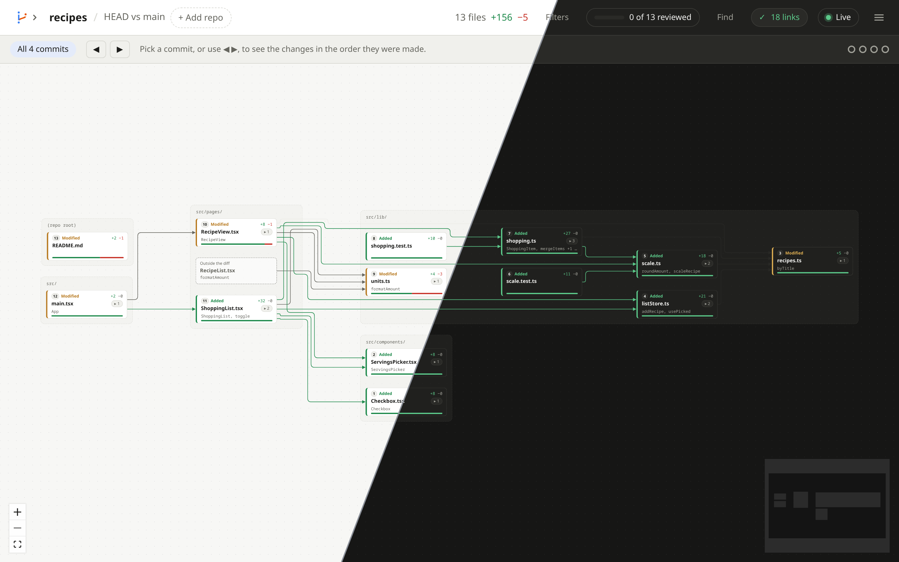

# canvas-review

See what changed in a git repo, and how the changes connect, on a canvas
in your browser. Made for reviewing work done by coding agents.


- Each changed file is a card, grouped by folder.
- An arrow from A to B means A uses names that B defines.
- Click a file to see its changed functions and types, its links, and its diff.
- Green links point at new shared code, so you can check the right file owns it.
- Files are numbered in reading order, so you meet the building blocks first.
- Filters narrow the canvas: by folder, language, impact, unused code and more.
- Live mode follows along while an agent works.
- Put several repos on one canvas, when one change spans services.
- See the worktrees your agents work in, side by side.
- Find a file on the canvas by typing part of its name.
- Open a file in your editor, and commit or discard without leaving the page.

It follows your system's light or dark mode.



This repo holds release binaries and docs only.

## Install

**Linux and macOS**

```sh
curl -fsSL https://raw.githubusercontent.com/Stjerna/canvas-review/main/install.sh | sh
```

**Windows** (PowerShell, not tested)

```powershell
irm https://raw.githubusercontent.com/Stjerna/canvas-review/main/install.ps1 | iex
```

It updates itself once a day. See [Install](docs/install.md) for
versions, updates and installing by hand.

## Quick start

Run it inside a git repo:

```sh
canvas-review
```

It opens the canvas in your browser, on your uncommitted changes, even
when there are none yet. That way an agent's edits show up live. Use
`-b main` for your branch's work, or `-l 1` for the last commit.

## Docs

- [Install](docs/install.md): install scripts, updates, versions, by hand
- [Usage](docs/usage.md): ranges, flags, keyboard shortcuts
- [Reviewing a change](docs/reviewing.md): the canvas, what the links
  mean, a file's panel, reading order, live mode
- [Filters](docs/filters.md): narrow the canvas to the files you care about
- [Several repos](docs/multiple-repos.md): other repos, several on one
  canvas, and worktrees
- [Git](docs/git.md): fetch, pull, push, commit and discard
- [Language servers](docs/language-servers.md): better links

## Privacy

Everything runs on your machine. The local server only answers requests
that carry the secret token in the link it prints, so other websites
can't read your code through it.
