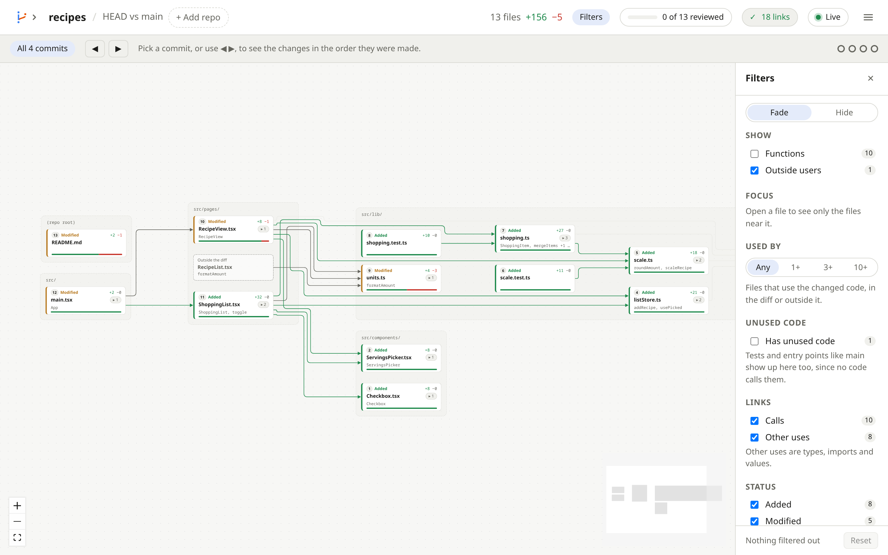

# Filters

[← Back to the README](../README.md)

Filters narrow the canvas to the files you care about. Click **Filters**
in the top bar, or press **F**, to open the panel on the right.

## Fade or hide

- **Fade** keeps filtered-out files in place, faded.
- **Hide** takes them off the canvas.

The **Filters** button shows how many files or links are filtered out.
**Reset** clears every filter.

## What you can filter

- **Show:** **Functions**, **Outside users** and **Generated**. See
  [Reviewing a change](reviewing.md).
- **Focus:** open a file, then click **Focus on …**. Only files 1, 2 or 3
  links from it stay.
- **Leave out:** files you have reviewed, and files where only comments
  or blank lines changed.
- **Used by:** only files whose changed code 1, 3 or 10 or more files
  use, in the diff or outside it.
- **Unused code:** tick **Has unused code** to see only files with changed
  functions, classes or types that nothing uses. Needs a
  [language server](language-servers.md). Tests and entry points like
  `main` show up too, since no code calls them.
- **Links:** **Calls**, or **Other uses** (types, imports and values).
- **Status**, **Symbol change**, **Symbol kind**, **Language** and
  **Folder:** untick what you don't want. Hover a row and click **Only**
  to keep just that one.

## While you review

- The open file always stays on the canvas.
- **N**, **P** and the next-file button skip filtered-out files.
- The reviewed count still counts every file, so a filter can't make a
  review look done.
- In live mode, the note at the bottom says how many updated files are
  filtered out.

## Panel width

Drag the inner edge of the filter panel to make it wider or narrower. Or
click the edge and use the arrow keys. Double-click the edge to reset it.
The width is kept in your browser.
