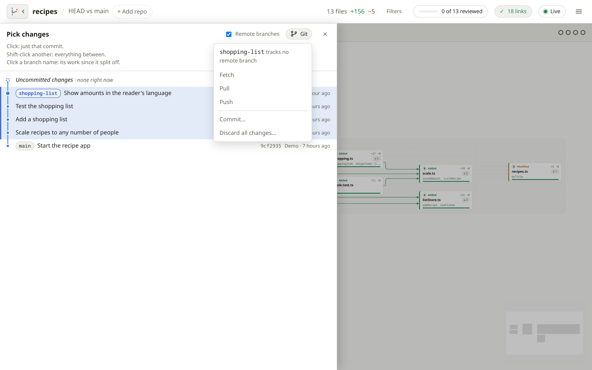

# Git

[← Back to the README](../README.md)

canvas-review can fetch, pull, push, commit and discard for you, so you
can finish a review without going back to the terminal.

## The Git button

Open the branch graph with **G**, or the branch icon at the top left. The
**Git** button is at its top.

The button shows **↓2** when there are 2 commits to pull, and **↑1** when
there is 1 to push. With several repos, each repo's branch graph has its
own **Git** button.

- **Fetch** downloads new commits. Your files stay as they are.
- **Pull** brings in new commits. It only fast-forwards. If both sides
  have new commits, it stops and asks you to merge or rebase in a
  terminal.
- **Push** sends your commits. A new branch is pushed to `origin` and
  tracks it from then on.
- **Commit…** commits the files on the canvas, with a message.
- **Discard all changes…** throws away every change on the canvas.

## Commit

**Commit…** opens a list of the files on the canvas.

- Untick files to leave them out.
- Click **Reviewed only** to commit just the files you ticked as
  reviewed.
- Other staged changes stay out of the commit.

## Discard changes

- **Discard all changes…** in the Git menu throws away every change on
  the canvas.
- To throw away one file's changes, open it and click **Discard…**.

Changed and deleted files go back to the last commit. New files are
deleted. A note at the bottom has **Undo**, which works until
canvas-review stops.

## Good to know

- Commit and discard need the **Uncommitted changes** range.
- Git runs with your own config, so remotes, credentials and commit hooks
  work like in a terminal.
- It never asks for a password. If a remote needs one you have not saved,
  the action fails and says so.
