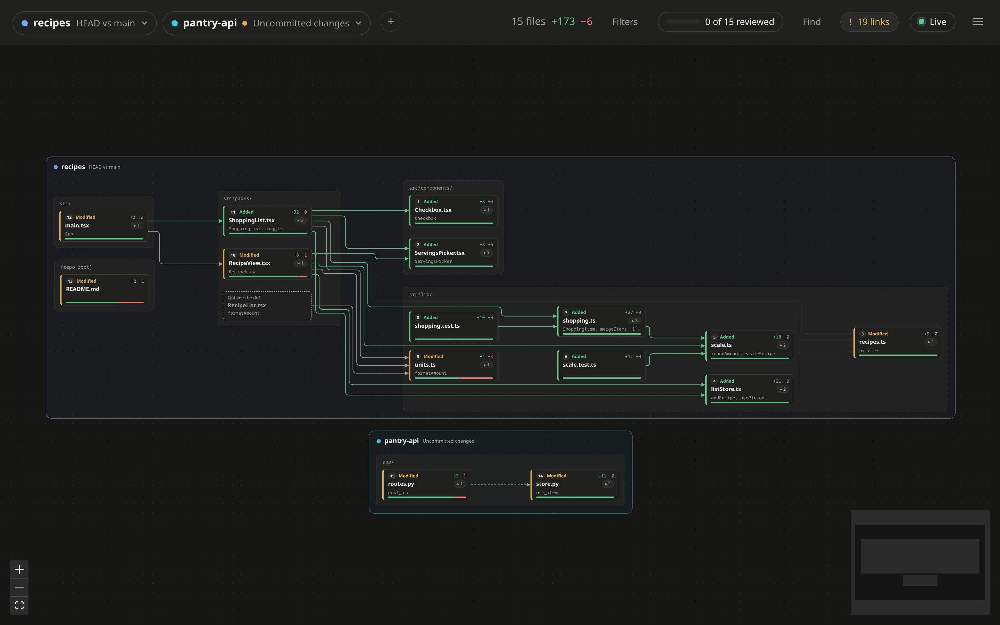
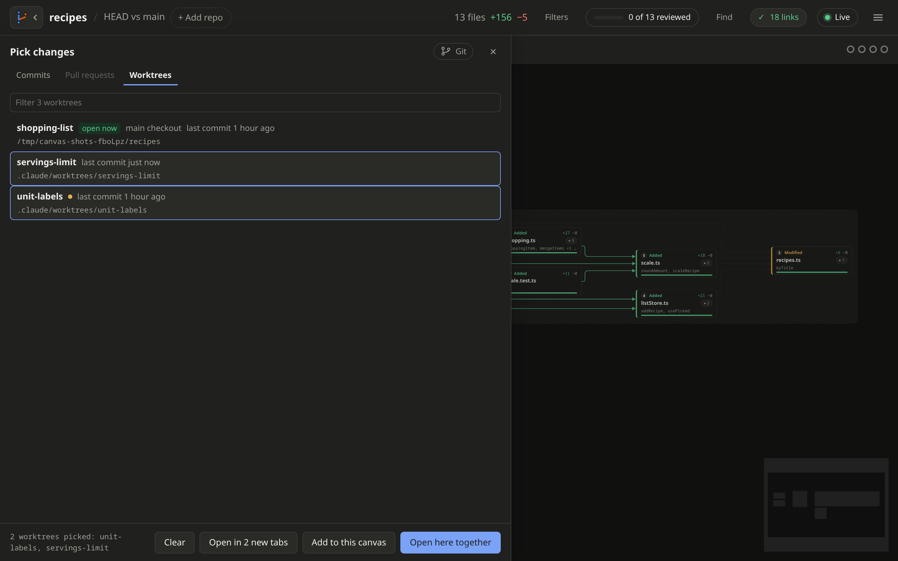

# Several repos

[← Back to the README](../README.md)

## Open another repo

Click the repo name at the top left, press **O**, or pick **Open another
repo** in the menu. Pick one of your last 5 repos, or browse your
folders. Repos are shown in bold. Double-click a repo to open it right
away.

Type in the search box to find a repo by name, in Recent and in the
folder shown. **Enter** opens it.

## Pick several repos

Click like in a file manager:

- Click picks one repo.
- Ctrl+click (Cmd+click on macOS) adds or drops one repo.
- Shift+click picks every repo from your last click to this one.

Then:

- **Open here** swaps the repo in this tab. With several picked, it opens
  them together on one canvas.
- **Open in new tab** keeps this one too. Each tab runs at the same time,
  with its own live mode and language servers. If the browser blocks some
  tabs, the picker says so and stays open.
- **Add to this canvas** shows the picked repos next to the ones open now.

## Several repos on one canvas

Useful when one change spans services, like a frontend, a BFF and a core
service. Add a repo with **+ Add repo** in the top bar, or **Add to this
canvas** in the repo picker.



From the terminal, repeat `-r`:

```sh
canvas-review -u -r ../frontend -r ../core
```

A range flag, like `-u`, applies to every repo. With no range flag, each
repo opens on its uncommitted changes.

Each repo gets its own box on the canvas, and a chip in the top bar, in
the same color.

- Each repo has its own range. Click its chip, or the name on top of its
  box, to pick it. **G** does it for the repo of the open file.
- Point at a chip to light up its repo on the canvas.
- The **✕** on a chip's corner takes the repo off the canvas.
- Live mode watches every repo, and reloads only the one that changed.
- The [reading order](reviewing.md#reading-order) goes repo by repo: all
  files of the first repo, then all of the next.

Once a canvas shows several repos, **Open here** is replaced by **Add to
this canvas**, so one click can't throw the set away. **Open in new tab**
still works.

Good to know:

- Files are linked within a repo, not across repos.
- Stepping through commits only works with one repo, since commits in
  different repos don't line up.

## Worktrees

Coding agents often work in a
[git worktree](https://git-scm.com/docs/git-worktree): a second checkout
of the repo, on its own branch, like `.claude/worktrees/fix-login`. Each
worktree opens like any other repo.



Press **G** to open the branch graph, then click the **Worktrees** tab.

- The main checkout comes first, then each worktree.
- Each row shows its branch, its folder, and when its last commit was
  made.
- An orange dot means it has uncommitted changes.
- **open now** means it is on the canvas already.
- A worktree whose folder was deleted shows faded, and can't be picked.

Pick them like repos: click, Ctrl+click or Shift+click. Then use **Open
here**, **Open in new tab** or **Add to this canvas**, as
[above](#pick-several-repos). Add a few worktrees to one canvas to
compare what each agent did.

Worktrees kept inside the repo don't count as uncommitted changes in the
main checkout.

## Saved in the URL

The repos and their ranges are part of the page URL. So each tab
remembers its own, and a bookmark brings the same set back.

Recent repos are kept in:

- Linux: `~/.local/state/canvas-review/recent.json`
- macOS: `~/Library/Application Support/canvas-review`
- Windows: `%LOCALAPPDATA%`
