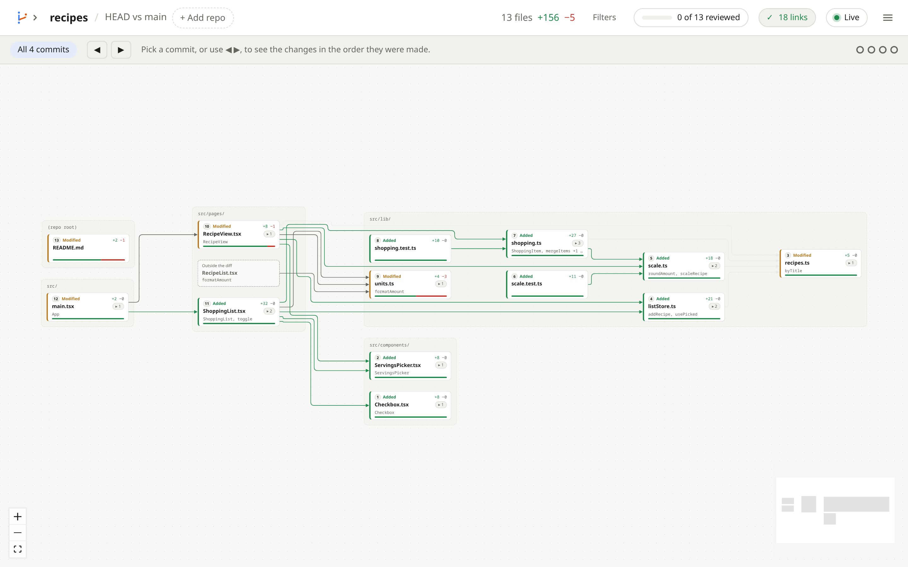
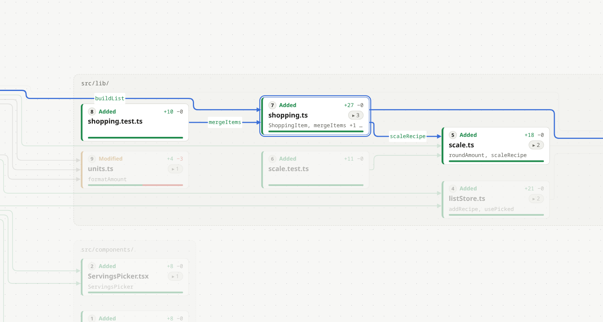
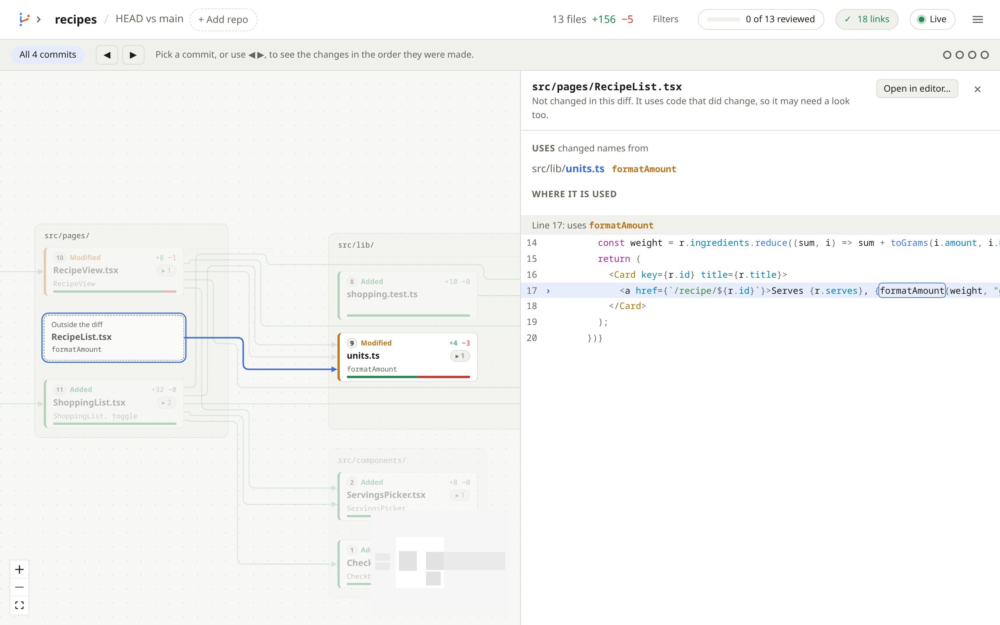
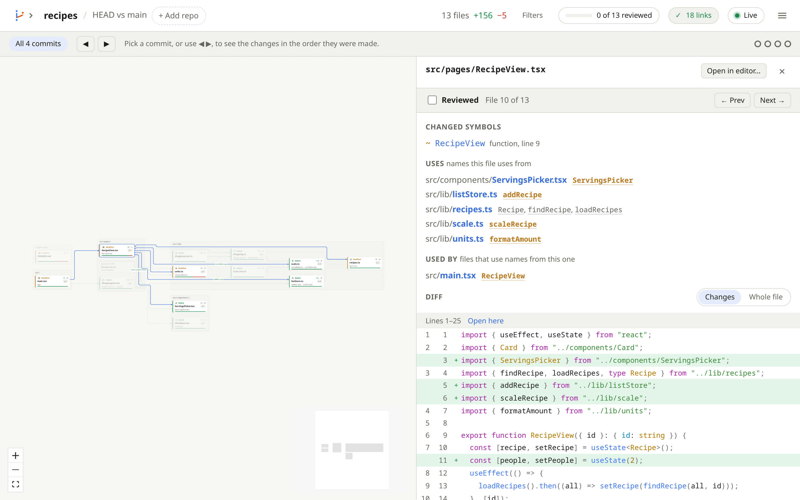
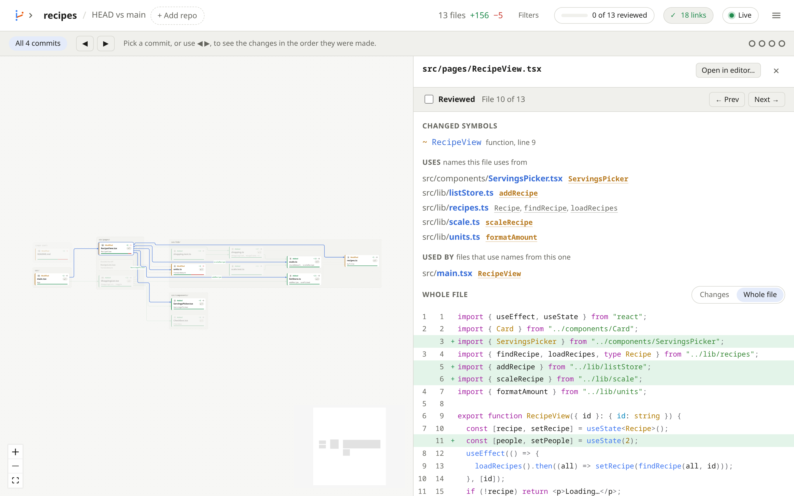
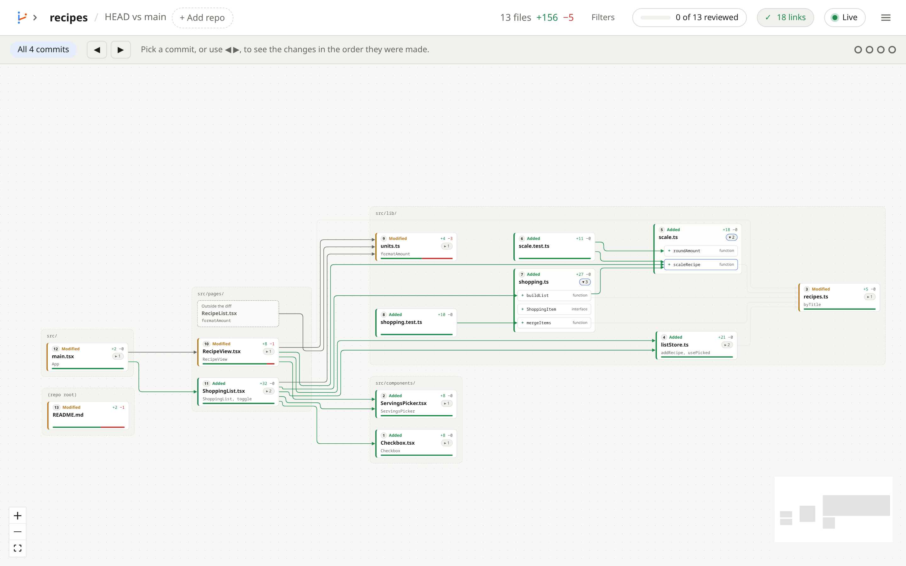
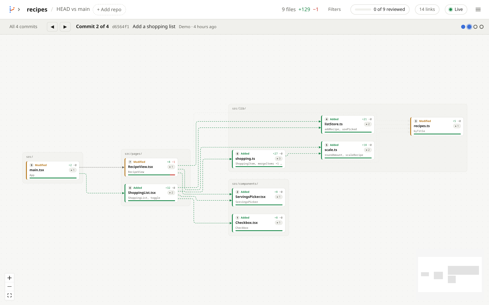
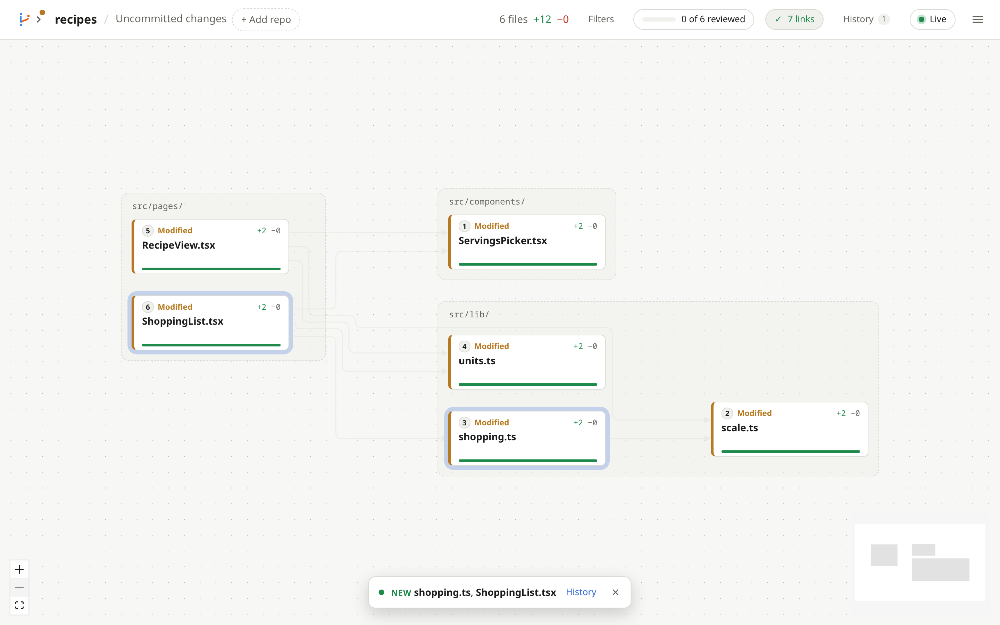
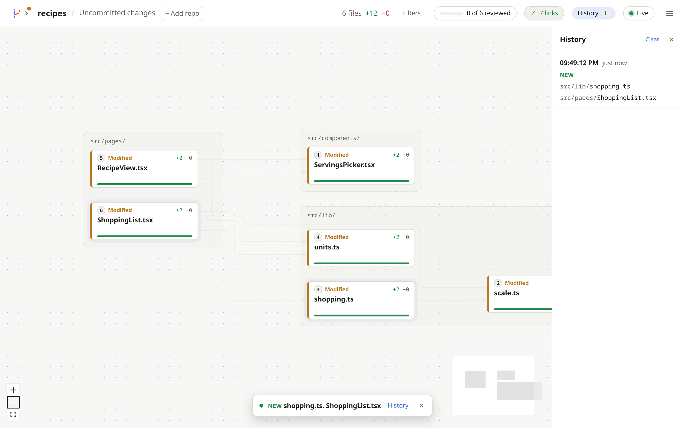

# Reviewing a change

[← Back to the README](../README.md)

## The canvas



- Each changed file is a card, grouped by folder.
- An arrow from A to B means A uses names that B defines.
- Click a file to see its changed functions and types, its links, and its
  diff.
- Lock files and other generated files are hidden. Show them with
  **Generated** in the [filters](filters.md). Mark your own with
  `linguist-generated` in `.gitattributes`.

To see only some files, like one folder or the files near one file, use
the [filters](filters.md).

Supported languages, with colors and links: Rust, Python, JavaScript,
TypeScript, Go, Java, C, C++, Ruby, C#, PHP, Kotlin, Swift, Scala, Lua,
Bash, Elixir, Zig and Haskell. CSS, HTML and JSON get colors only. Other
files still show up, without colors or links.

### Reading a card

- **Number:** where the file comes in [reading order](#reading-order).
- **Added**, **Modified**, **Deleted** or **Renamed**, with a colored
  edge to match.
- **+10 −2:** lines added and removed. The bar at the bottom shows the
  same, in green and red.
- **Names** under the file name: its changed functions, types and other
  symbols.
- **▸ 3:** open the card to show those symbols. See
  [Function view](#function-view).

## Reading the links



Links run from the file that uses a name to the file that defines it.

**What the link uses:**

- **Green:** names the diff **added** to the other file. This is new
  shared code. Check that the right file owns it.
- **Grey:** names the diff **changed**.
- **Faint:** only names the diff **didn't touch**. They stay faint until
  you pick one of their files.

**How sure it is:**

- **Solid:** a [language server](language-servers.md) checked it.
- **Dashed:** found by matching names, which can be wrong.

**What you're looking at:**

- **Blue:** the link touches the file you picked. Its green links show
  the new names on them.
- **Very faint:** the link doesn't touch the picked file, or a filter
  leaves it out.
- **Hover** any link to see every name it uses.

Blue wins over the other colors. So a green link turns blue when you pick
its file, but keeps its green names.

The **✓ 18 links** button in the top bar counts the links, and shows
whether language servers checked them.

## Files outside the diff



Dashed cards are files the diff didn't touch, but that use changed code.
A change there might break them. Click one to see the code around each
use.

Toggle them with **Outside users** in the [filters](filters.md). If there
are more than 30, they start hidden.

## A file's panel



Click a card to open its panel on the right.

- **Changed symbols:** the functions, types and other names that changed.
  **+** is added, **~** changed, **−** removed. Click one to jump to it
  in the diff.
- **Uses:** names this file uses, and the files they come from. Names the
  diff changed are in bold orange.
- **Used by:** files that use names from this one.
- **Diff:** the changed lines, with colors.

Drag the panel's left edge to make it wider or narrower. Or click the
edge and use the arrow keys. Double-click the edge to reset it.

### See the whole file



Above the diff, click **Whole file**, or press **W**. It shows every
line, with the changes marked in place. Click **Changes** to go back to
just the diff. Your pick stays as you move between files.

Scroll the code with **J** or **↓** to go down, and **K** or **↑** to go
up.

### Jump along links

In a file's **Uses** and **Used by** lists, click a name to open the
other file right at it:

- **Used by:** where that file uses the name.
- **Uses:** where that file defines the name, even if it didn't change.

The code shows at the top of the panel, with a **Back** button.

### Open in your editor

Click **Open in editor** at the top of the panel, or press **E**. It
opens the file at the first changed line. Each block of the diff has
**Open here**, to open at that block.

The first time, pick your editor. canvas-review lists the ones it finds:
VS Code, Cursor, Windsurf, VSCodium, Zed, Sublime Text, JetBrains IDEs,
Kate, GNOME Text Editor and Emacs. Neovim, Helix and Vim open in a new
terminal window: `$TERMINAL`, else the first terminal it finds.

For anything else, pick **My own command**. `{file}`, `{line}` and
`{column}` are filled in. For example:

```
tmux new-window nvim +{line} {file}
```

Your pick is saved in `canvas-review/settings.json` in your config folder
(`~/.config` on Linux). Change it from the **☰** menu. The file opens as
it is on disk now, even when you look at older commits.

### Discard a file's changes

Click **Discard…** in the panel to throw away that file's changes. See
[Git](git.md#discard-changes).

## Reading order

Each file card has a number. Files come after the files they use, so you
meet the building blocks first. Files with no links, like docs and
config, come last.

- Click **0 of N reviewed** in the top bar to open the next file to read.
- In a file, tick **Reviewed**, or use **Prev** and **Next**.
- Keys: **N** next file, **P** previous file, **R** mark reviewed,
  **Esc** close the file.

Ticks are kept in your browser. If a reviewed file changes again, it
counts as unreviewed until you look at it again.

## Function view



Click the **▸ 3** button on a file card to show its changed functions,
classes and other symbols inside it. Links then run between functions,
not whole files.

- **Functions** in the [filters](filters.md) opens or closes every file.
- Click a function to jump to it in the diff.

## Step through commits



When a range has more than one commit, a bar under the top bar lets you
walk them in order. Each step shows the range up to that commit, and the
files it touched glow.

- Use the **◀ ▶** buttons, the dots, or the **[** and **]** keys.
- **All N commits** goes back to the whole range.

Language servers don't check links while stepping, since they read the
files on disk. So links show **dashed**. Stepping only works with one
repo on the canvas.

## Live mode



Live mode is on by default. While an agent works, the canvas follows
along when files change or commits land.

- Changed files glow for a moment.
- A note at the bottom names them: new, changed, or no longer changed.
- The camera stays where you left it.

Click **Live** in the top bar to pause.

With no uncommitted changes yet, the canvas says **No changes yet**, and
fills in as soon as files change.

### History



The note goes away after a few seconds. To look back, click **History**
in the top bar or in the note, or press **H**.

- Each live update is listed, newest first, with its time.
- It shows which files were new, changed, or no longer changed.
- Click a file to open it.
- Picking a new range starts a fresh history. **Clear** empties it.

Reloading the page keeps the history, until the tab closes.
