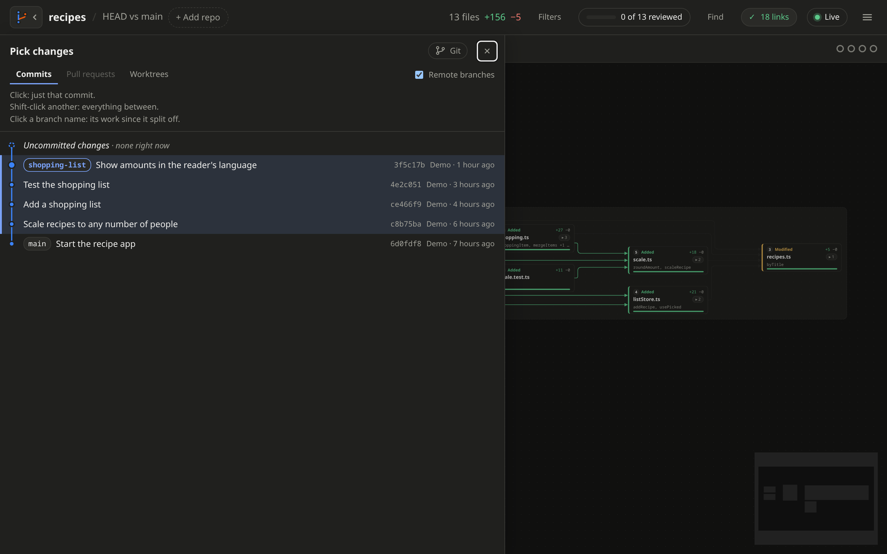

# Usage

[← Back to the README](../README.md)

## Run it

Run it inside a git repo:

```sh
canvas-review            # open the canvas on the likely range
canvas-review -u         # uncommitted changes
canvas-review -l 3       # last 3 commits, bundled
canvas-review -b main    # current branch vs main
canvas-review --from A --to B
canvas-review -r ../other-repo   # a repo other than the one you are in
canvas-review -u -r ../web -r ../api   # several repos on one canvas
```

Repeat `-r` to open [several repos](multiple-repos.md) on one canvas. A
range flag, like `-u`, then applies to each repo. A bad repo or ref stops
it right away.

With no range flag it opens on uncommitted changes, even when there are
none yet. That way an agent's edits show up live, in every repo. Repos
you open from the browser get a likely range instead: uncommitted
changes, else your branch's work since it left `main`, else the last
commit.

Outside a git repo, it opens on a repo picker instead.

## Pick a range in the browser



Click the branch icon at the top left, or press **G**. It opens a branch
graph, like `git log --graph`. An orange dot on the icon means there are
uncommitted changes.

- Click a commit to see just that one.
- Shift-click a second commit to see everything between them. Commits on
  different branches are compared directly.
- Click a branch name to see its work since it split off from `main`.
- Click **Uncommitted changes** at the top for work not committed yet.
- Branches like `origin/main` show too. Untick **Remote branches** to
  hide them.

To compare any two refs, use `--from A --to B` on the command line.

The link at the top of the branch graph opens the repo on the web, like
`github.com/owner/repo`.

### Pull requests

The **Pull requests** tab lists the open pull requests on GitHub.

- Type to filter them.
- Click one to see its changes: from where it split off its base to its
  last commit. Pull requests from forks work too.
- **↗** opens it on the web.

It needs the [GitHub CLI](https://cli.github.com) (`gh`), logged in.

### Worktrees

The **Worktrees** tab lists the repo's worktrees, like the ones agents
make in `.claude/worktrees/`. Pick them like repos, to open here, in new
tabs, or next to each other on the canvas. See
[Worktrees](multiple-repos.md#worktrees).

The range is kept in the page URL, so Back, Forward and reload work.

Drag the right edge of the branch graph to make it wider or narrower. Or
click the edge and use the arrow keys. Double-click the edge to reset it.

The **Git** button at the top of the branch graph fetches, pulls, pushes
and commits. See [Git](git.md).

## Keyboard shortcuts

| Key | Does |
|---|---|
| **G** | Pick a range |
| **O** | Open or add another repo |
| **/** | [Find a file](reviewing.md#find-a-file) on the canvas |
| **N** / **P** | Next / previous file in reading order |
| **R** | Mark the open file reviewed, or not |
| **W** | Switch between the diff and the whole file |
| **J** / **K** | Scroll the open file down / up (or **↓** / **↑**) |
| **H** / **L** | Scroll the open file left / right (or **←** / **→**) |
| **Shift** + **H J K L** | Open the nearest file box that way (or **Shift** + an arrow) |
| **E** | Open the open file in your editor |
| **F** | Open or close the [filters](filters.md) |
| **U** | Open or close the live history |
| **[** / **]** | Step through the commits in a range |
| **Esc** | Close the open file, drawer or dialog |
| **?** | Show all shortcuts |

## Menu

The **☰** button at the top right has **Refresh**, **Open another
repo**, **Editor** and **Keyboard shortcuts**. **Editor** picks the
editor that [Open in editor](reviewing.md#open-in-your-editor) uses.

## Open it from an agent

You can ask a coding agent to open the canvas for you. For example, once
you and the agent agree on a plan, say: "Open canvas-review on all the
repos we will change." Then you watch its edits arrive live.

The agent can work out how from `canvas-review --help`. What it needs to
know:

- Name each repo with `-r`. All of them go on one canvas.
- Use `-u`, uncommitted changes, to follow edits as they happen.
- Start it in the background. It runs until Ctrl+C, and never exits by
  itself.
- It opens the browser tab itself. Run it once; live mode does the rest.

```sh
canvas-review -u -r ../frontend -r ../bff -r ../core-service
```

The tab says **No changes yet** until the first edit lands.

Commits leave the uncommitted range. If the agent commits as it goes,
press **G** to pick those commits.

## Stop it

Press Ctrl+C in the terminal. Tabs opened with **Open in new tab** close
by themselves. Browsers don't let a page close the first tab, so it shows
**Canvas stopped** instead.

## Other flags

- `--print` lists changed files in the terminal instead.
- `--json` prints the raw change data.
- `--port N` and `--no-open` control the local server.
- `--no-lsp` skips language servers. `--lsp-timeout SECS` sets how long
  to wait for indexing (default 120).

Run `canvas-review --help` for all flags.
